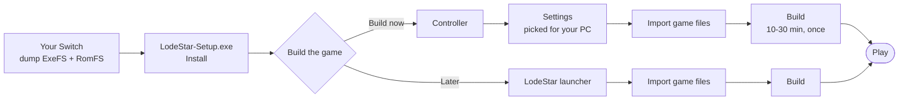
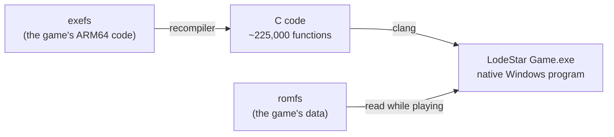
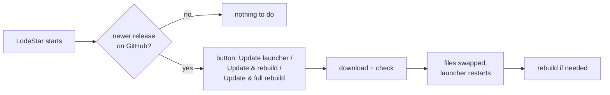

<p align="center">
  
</p>

<h1 align="center">LodeStar - step by step</h1>

<p align="center">From your own Switch dump to Pokémon Legends: Arceus running natively on your PC.</p>

---

## The whole way at a glance



What LodeStar does with your dump, once, on your PC:



Nothing is emulated: the game's code is translated ahead of time and compiled for your processor.

---

## 1. Dump your game

You need the **base game, version 1.0.0** (without updates), as two already-extracted folders:

| Folder | Holds |
|---|---|
| `exefs` | `main`, `main.npdm`, `rtld`, `sdk`, `subsdk0`, `subsdk1` |
| `romfs` | `bin/`, `system_resource/` |

On a Switch that can run homebrew, **nxdumptool** dumps both: pick the game, then *Dump ExeFS* and *Dump RomFS* of the base program. Copy the two folders to your PC, e.g. into one folder `Arceus dump\`.

> LodeStar contains no game files and never will. Only your own copy works.

---

## 2. Install

Run **`LodeStar-Setup-x.y.z.exe`** from the [Releases](../../../releases) page.

```text
┌────────────────────────────────────────────────────────────┐
│  ★  Welcome to LodeStar                                     │
│                                                            │
│     This installs the LodeStar launcher on your PC.         │
│     No game files are included.                             │
│                                                            │
│  Install to:  C:\Users\you\AppData\Local\Programs\LodeStar  │
│  [x] Create a desktop shortcut                              │
│                                                            │
│  ████████████████████████░░░░░░░░  Installing...            │
│                                          [ Back ] [Install] │
└────────────────────────────────────────────────────────────┘
```

- No administrator rights needed; everything goes into one folder.
- If Python is missing, the installer adds it (Windows' winget).
- LodeStar then shows up once under **Settings → Apps → Installed apps** and in the Start menu.

---

## 3. Build now, or later

The last installer page asks:

```text
┌────────────────────────────────────────────────────────────┐
│  Build the game                                             │
│                                                            │
│   (•) Build now                                             │
│   ( ) Build later, in the launcher                          │
│                                                     [Next]  │
└────────────────────────────────────────────────────────────┘
```

**Build now** opens the setup wizard:

```text
┌───────────────┬────────────────────────────────────────────┐
│ LodeStar      │  Controller                                │
│ Setup         │                                            │
│               │  ✓ 1 controller connected                  │
│  ✓ Controller │                                            │
│  2 Settings   │  [ Set up the controller ] [ Keyboard ]    │
│  3 Game files │                                            │
│  4 Build      │                                            │
│  5 Done       │                              [Back] [Next] │
└───────────────┴────────────────────────────────────────────┘
```

| Step | What you do |
|---|---|
| **Controller** | Plug it in (Xbox and most PC pads). *Set up the controller* lets you test and remap every button; keyboard and mouse work too. |
| **Settings** | Already filled in for your PC (processor, memory, graphics card). Choose where the extra quality goes: **Graphics card** (sharper picture), **Balanced**, or **Processor** (more people and Pokémon loaded far away). |
| **Game files** | *Import game files* → pick your `Arceus dump\` folder. LodeStar checks both folders and the version, then copies them into its `Game\` folder. |
| **Build** | *Build now*. Missing build tools (Visual Studio C++, LLVM, .NET, Vulkan SDK) are installed first - Windows may ask for permission. Then one progress bar for everything: |

```text
  Step 3 of 3: Compiling
  ███████████████████████████████░░░░░░░░░░░░   72 %   ·   8:14 so far   ·   about 3:10 left
  sw_chunk_2417.c
```

---

## 4. The launcher

Start **LodeStar** from the Start menu or the desktop.

```text
┌──────────────────────────────────────────────────────────────────┐
│  ★ LodeStar                                   ☾ Dark  ⚙  [Ready] │
│    Native PC build of Pokémon Legends: Arceus · by Kimo [Uninstall]│
│ ┌──────────────────────────────────────────────────────────────┐ │
│ │  Ready to play                     [ Play ] [Update] [ Stop ] │ │
│ │  ████████████████████████████████████████████████████████    │ │
│ └──────────────────────────────────────────────────────────────┘ │
│  [ Overview ] [ Build ] [ Log ] [ Mods ]                          │
│  Saves & cheats · Controls · Options · History                    │
└──────────────────────────────────────────────────────────────────┘
```

| Where | What it is for |
|---|---|
| **Play** | starts the game |
| **Update** | appears only when a new LodeStar release exists - it says whether the update needs a rebuild |
| **Build** tab | Import game files, Recompile, Build (if you chose *Later*) |
| **Mods** tab | your mods, the mod browser (GameBanana, GitHub collections, Nexus Mods) |
| **Saves & cheats** | import / export saves, a save library, the save editor |
| **Controls** | keyboard, mouse and controller layouts |
| **Options** (⚙) | frame rate, resolution scale, DLAA, distances, frame generation, *Recommended for this PC* |
| **Uninstall** (red) | removes LodeStar's folder; asks first whether to keep a copy of your saves |

---

## 5. In the game

| Key | |
|---|---|
| **F1** or **Minus + Plus** | settings menu: frame rate, resolution, frame generation, distances, sound, controls |
| **F2** | mouse camera on / off |
| **F3** / **F10** | FPS counter / performance overlay |
| **F4** | mods menu |
| **F11** | fullscreen |

---

## 6. Updates



Your game files, mods, settings, saves and built game are never touched by an update.

---

## If something goes wrong

| You see | Do this |
|---|---|
| *Import*: "No ExeFS found" | pick the folder that holds **both** `exefs` and `romfs` |
| *Import*: version 1.1.1 | dump the **base** game (1.0.0), without the update |
| *Build* fails | press *Retry*; the log path is shown under the progress bar (also in the launcher's **Log** tab) |
| "This PC cannot run LodeStar" | the processor needs AVX2 (Intel Haswell / AMD Ryzen or newer) and a Vulkan graphics driver |
| Low frame rate with high *Simulation distance* | that setting is processor work - lower it, or turn on frame generation |
